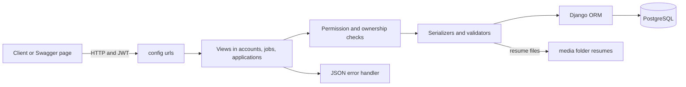
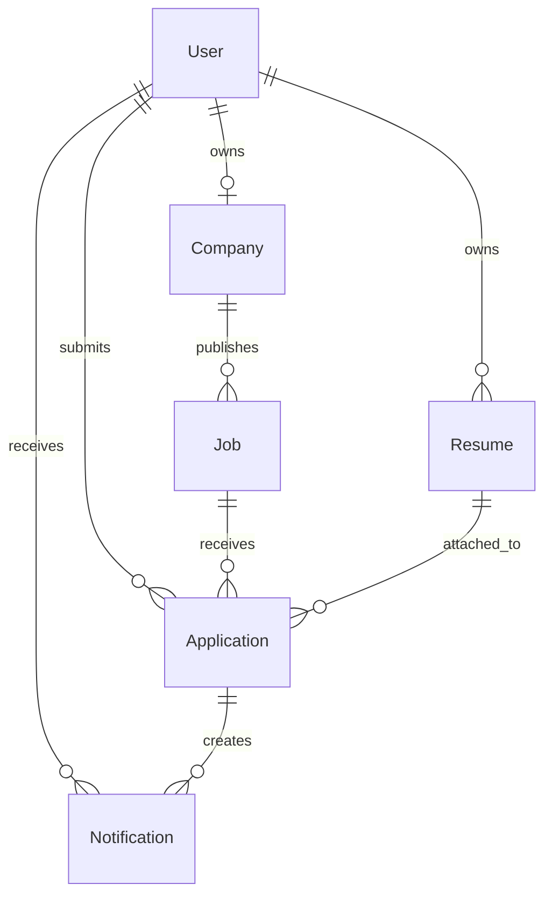
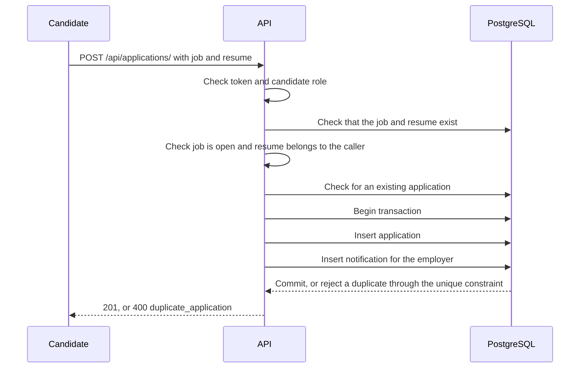

# Design

How the Job Board API was planned, built and checked. For the decisions behind individual choices, see [DECISIONS.md](./DECISIONS.md). For setup, see [README.md](./README.md).

## 1. The problem

Employers publish jobs. Candidates keep resumes and apply. Employers move applications through statuses and get notified when someone applies. There is no frontend, so the API and its Swagger page are the whole product.

The parts that can go wrong are the ones that involve trust and shared state:

- Who is allowed to do what (employer versus candidate, and owner versus stranger).
- Two requests arriving at the same time (a duplicate apply).
- Files uploaded by strangers (resumes).
- Input that was never meant to be valid (huge numbers, odd characters).

I planned around those four, not around the number of endpoints.

## 2. How I started

I started from the CodeAlpha task sheet and drew the data model on paper first: the tables and how they connect. Then I built the project one step at a time.

Before any code existed I decided:

- Scope: job fields modelled on Jobright, only what the task sheet asks for. I left out match scores, autofill and Google login.
- Stack: Django, DRF, JWT and PostgreSQL.
- Rules: the backend checks resume ownership, employers can only change an application's status, and every error returns the same JSON shape.
- Process: tests first, and each step tested before the next one started.

The decision I spent the most time on was the diagram, meaning the data model and how the tables connect, and keeping it inside the scope of the task so I did not bloat it with extra tech.

## 3. System shape

Three Django apps keep responsibilities apart:

| App | Owns |
|---|---|
| `accounts` | The custom user, the employer or candidate role, register, login, me |
| `jobs` | Companies, jobs, public read endpoints, search filters |
| `applications` | Resumes, applications, status changes, notifications |

## 4. Data model

Two rules live in the database, not only in code:

- One company per employer (OneToOne).
- One application per candidate and job (unique constraint `unique_application_per_candidate_job`).

Code checks can be skipped by a bug or beaten by two simultaneous requests. A database constraint cannot.

## 5. The apply flow

This is the most important path, so it gets its own diagram.

The checks before the transaction give clean errors. The unique constraint is the backstop if two requests get past the duplicate check together. The application and its notification are written in one transaction, so one never exists without the other.

## 6. Tradeoffs

| Choice | Taken | Rejected | Reason |
|---|---|---|---|
| Authentication | SimpleJWT | Own token code | A tested library is safer than code I would have to secure myself |
| Duplicate protection | Database constraint | Code check only | Two simultaneous requests can both pass a code check |
| Resume validation | Extension, size and file signature | File name only | A renamed file can pretend to be a PDF |
| Notifications | Written in the same transaction | A background worker | Simpler and consistent at this size. A worker is the next step at scale |
| Application history | Protected from deletion | Cascade delete | History should not vanish by accident |
| Docs | Swagger from the existing views | Rewriting views so the schema is guessed | Documentation should not change tested behavior |

## 7. What I left out on purpose

Each of these is a real feature. I left them out to keep the core small and correct:

- Reporting and application statistics.
- A refresh token endpoint. Login returns a refresh token, but nothing consumes it yet.
- A resume download endpoint.
- Rate limiting on login.
- CORS headers for a browser frontend on another address.
- Production hardening: HTTPS, secret handling, `DEBUG=False` with a configurable `ALLOWED_HOSTS`.

## 8. Build order

1. Custom user, roles, register, login, error shape.
2. Company and job write endpoints.
3. Public job reads and search filters.
4. Resume, application and notification models.
5. Resume upload and the apply flow.
6. Admin, demo data command, Swagger docs.
7. Documentation hints for Swagger.

Each step was finished and tested before the next started, because later steps depend on the permission and error rules of earlier ones.

## 9. How it was tested

| Layer | What it proves | Result |
|---|---|---|
| Automated tests | Rules for roles, ownership, validation, filters, the apply flow, errors, admin, docs routes | 248 tests, OK |
| Real HTTP checks | 139 checks against the running server with `DEBUG=True` | 139 passed, 0 failed |
| Simultaneous apply | 10 requests at once by one candidate for one job | 1 x 201, 9 x 400 `duplicate_application`, no 500, then exactly 1 application and 1 notification in the database |
| Fresh clone | A new folder, new virtual environment and empty database, following the README | Installed, migrated, seeded, docs page loaded, login returned tokens, unknown URL returned JSON |

Passing tests did not prove everything. Running the real server found problems the tests could not see, because the test runner switches `DEBUG` off and uses its own database:

- Unknown URLs returned an HTML page with `DEBUG=True`.
- Job write endpoints returned a different shape from job reads.
- Very large numbers, a null character in search text, and a very long job title caused server errors.
- There was no logging setting.
- One test depended on two clock readings being different, and failed at random.

Each was fixed and covered by a test. See [DECISIONS.md](./DECISIONS.md).

## 10. What I would do next

If this grew, the next steps would be:

- Move resume files to cloud storage.
- Add indexes on the search columns.
- Send notifications from a background worker.
- Add a refresh token endpoint.
- Make `ALLOWED_HOSTS` and `DEBUG` configurable for a real deployment.
