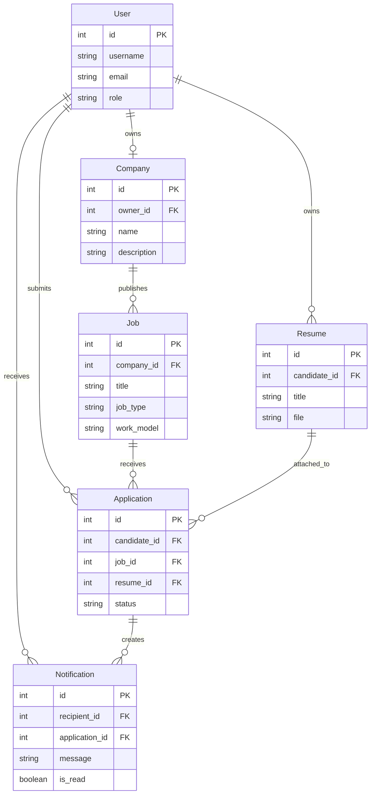
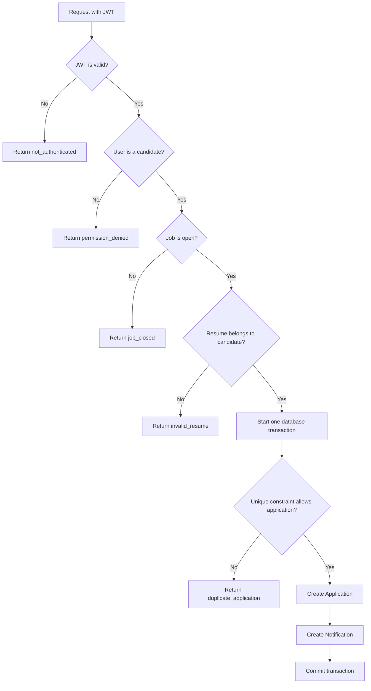

# Job Board API

This project is a job board API where employers can publish job listings and candidates can maintain resumes and apply for jobs. It includes account authentication, company and job management, resume and application workflows, and employer notifications.

## Stack

- Python
- Django
- Django REST Framework
- SimpleJWT
- PostgreSQL
- drf-spectacular for OpenAPI and Swagger documentation

## Setup

1. Create and activate a virtual environment:

   ```powershell
   py -m venv .venv
   .venv\Scripts\Activate.ps1
   ```

2. Install project dependencies:

   ```powershell
   pip install -r requirements.txt
   ```

3. Create a PostgreSQL database and user, then copy `.env.example` to `.env` and set the local database values and a local `SECRET_KEY`.

4. Apply the database migrations:

   ```powershell
   python manage.py migrate
   ```

5. Start the development server:

   ```powershell
   python manage.py runserver
   ```

## Run the tests

Run the app tests with:

```powershell
python manage.py test accounts jobs applications
```

## Try the API

Create the repeatable demo employer, candidate, company, and jobs:

```powershell
python manage.py seed_demo
```

The command prints the demo usernames and password. Open the Swagger page at [http://127.0.0.1:8000/api/docs/](http://127.0.0.1:8000/api/docs/) to explore the API.

## Data model



## Application flow



See [DECISIONS.md](./DECISIONS.md) for recorded implementation decisions.
