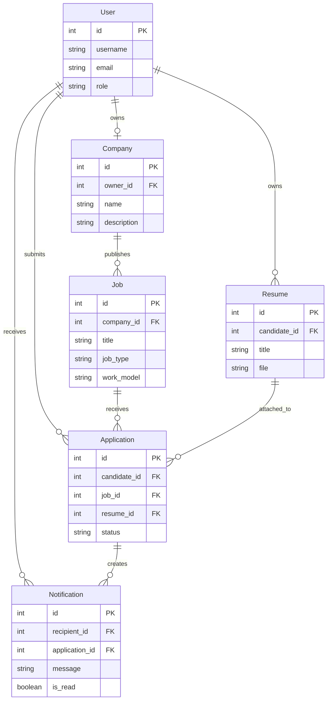
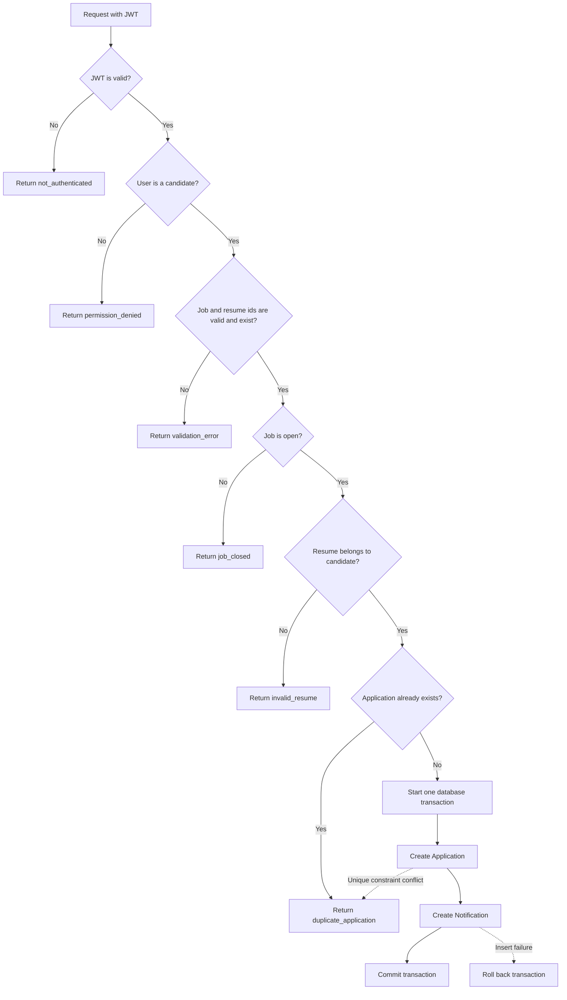

# Job Board API

This API lets employers publish jobs and candidates find and apply for them. It also provides resume upload, application status updates, and notifications for employers.

## Features

- Register and authenticate employer and candidate accounts with JWTs.
- Create companies and publish, update, close, and search job listings.
- Upload resumes and submit applications.
- Let employers review applications, update their status, and view notifications.
- Browse the OpenAPI schema and Swagger UI.

## Stack

- Python
- Django
- Django REST Framework
- SimpleJWT
- PostgreSQL
- drf-spectacular for OpenAPI and Swagger documentation

## Setup

1. Create and activate a virtual environment:

   ```powershell
   py -m venv venv
   venv\Scripts\Activate.ps1
   ```

2. Install project dependencies:

   ```powershell
   pip install -r requirements.txt
   ```

3. Create a PostgreSQL database and user, then copy `.env.example` to `.env` and set the local database values and a local `SECRET_KEY`.

   Set `DEBUG=True` for local use. Running with `DEBUG=False` is not supported yet, because `ALLOWED_HOSTS` is not configurable and the server would reject every request.

4. Apply the database migrations:

   ```powershell
   python manage.py migrate
   ```

5. Start the development server:

   ```powershell
   python manage.py runserver
   ```

## Try it in 2 minutes

Seed repeatable demo accounts, a company, and three open jobs:

```powershell
python manage.py seed_demo
```

The command prints the demo usernames and password. The demo password is for demo use only. Swagger loads its scripts from a CDN, so the docs page needs an internet connection.

Open [http://127.0.0.1:8000/api/docs/](http://127.0.0.1:8000/api/docs/) and follow this order:

1. Call `POST /api/auth/login/` with username `demo_employer` and the printed demo password. Copy the returned `access` token.
2. Click **Authorize** and enter `Bearer ` followed by the access token.
3. If the employer does not have a company, call `POST /api/company/` with `name` and `description`.
4. Call `POST /api/jobs/` with the job fields shown in the create-job example below. Valid `job_type` values are `full_time`, `part_time`, `contract`, and `internship`; `work_model` values are `remote`, `hybrid`, and `onsite`; `experience_level` values are `entry`, `mid`, and `senior`.
5. Call `POST /api/auth/login/` with username `demo_candidate` and the printed demo password. Replace the token in **Authorize** with this access token.
6. Call `POST /api/resumes/` using multipart form data with `title` and `file`. The file must meet the resume upload rules below.
7. Call `POST /api/applications/` with the created job id in `job` and resume id in `resume`.
8. Switch **Authorize** back to the employer access token. Call `PATCH /api/applications/<int:pk>/status/` with `{"status":"reviewing"}`, replacing `<int:pk>` with the application id from the apply response.
9. Call `GET /api/notifications/` to see the employer's notifications.

## Endpoints

| Method | Path | Who can call it | Purpose |
|---|---|---|---|
| POST | `/api/auth/register/` | Public | Register an account. |
| POST | `/api/auth/login/` | Public | Obtain JWT access and refresh tokens. |
| GET | `/api/auth/me/` | Employer or candidate | Get the authenticated account. |
| GET, POST, PATCH | `/api/company/` | Employer | View, create, or update the employer's company. |
| GET | `/api/jobs/` | Public | List open jobs and filter results. |
| POST | `/api/jobs/` | Employer | Create a job for the employer's company. |
| GET | `/api/jobs/<int:pk>/` | Public; owner employer can view a closed job | View a job. |
| PATCH | `/api/jobs/<int:pk>/` | Owner employer | Update a job. |
| POST | `/api/jobs/<int:pk>/close/` | Owner employer | Close a job. |
| GET | `/api/my/jobs/` | Employer | List the employer's jobs. |
| GET, POST | `/api/resumes/` | Candidate | List the candidate's resumes or upload one. |
| GET | `/api/applications/` | Employer or candidate | List applications visible to the authenticated user. |
| POST | `/api/applications/` | Candidate | Apply to a job with a resume. |
| GET | `/api/applications/<int:pk>/` | Applicant or job owner employer | View an application. |
| PATCH | `/api/applications/<int:pk>/status/` | Job owner employer | Change an application status. |
| GET | `/api/notifications/` | Employer | List the employer's notifications. |
| GET | `/api/schema/` | Public | Get the OpenAPI schema. |
| GET | `/api/docs/` | Public | Open the Swagger UI. |

## Example requests

### Register

```powershell
$body = @{
  username = $env:NEW_USERNAME
  email = $env:NEW_EMAIL
  password = $env:NEW_PASSWORD
  role = "candidate"
} | ConvertTo-Json

Invoke-RestMethod -Method Post `
  -Uri "http://127.0.0.1:8000/api/auth/register/" `
  -ContentType "application/json" `
  -Body $body
```

The body fields are `username`, `email`, `password`, and `role`. The role must be `employer` or `candidate`.

### Create a job

Use an employer access token and a company must already exist for that employer. The request fields match `JobSerializer`:

```powershell
$body = @{
  title = "Remote Backend Engineer"
  description = "Build and maintain reliable web APIs."
  location = "Lagos"
  job_type = "full_time"
  work_model = "remote"
  experience_level = "mid"
  min_years_experience = 3
  salary_min = 100000
  salary_max = 200000
} | ConvertTo-Json

Invoke-RestMethod -Method Post `
  -Uri "http://127.0.0.1:8000/api/jobs/" `
  -Headers @{ Authorization = "Bearer $employerAccessToken" } `
  -ContentType "application/json" `
  -Body $body
```

### Apply to a job

Use a candidate access token. Set `$jobId` and `$resumeId` to integer ids returned by the job create and resume upload requests.

```powershell
$body = @{ job = $jobId; resume = $resumeId } | ConvertTo-Json

Invoke-RestMethod -Method Post `
  -Uri "http://127.0.0.1:8000/api/applications/" `
  -Headers @{ Authorization = "Bearer $candidateAccessToken" } `
  -ContentType "application/json" `
  -Body $body
```

A successful response has this shape; ids and timestamps come from the created records:

```json
{
  "id": "<application id>",
  "job": "<job id>",
  "job_title": "<job title>",
  "company_name": "<company name>",
  "candidate_username": "<candidate username>",
  "resume": "<resume id>",
  "status": "applied",
  "applied_at": "<timestamp>",
  "updated_at": "<timestamp>"
}
```

Applying again to the same job returns HTTP 400 with:

```json
{
  "error": {
    "code": "duplicate_application",
    "message": "You have already applied for this job."
  }
}
```

## Error format

API errors use this JSON shape:

```json
{
  "error": {
    "code": "<error code>",
    "message": "<plain sentence>"
  }
}
```

Error codes used by the API are `validation_error`, `not_authenticated`, `permission_denied`, `not_found`, `method_not_allowed`, `server_error`, `duplicate_application`, `job_closed`, `invalid_resume`, and `invalid_transition`.

## Application statuses

The status values are `applied`, `reviewing`, `shortlisted`, `rejected`, and `hired`. Allowed moves are:

- `applied` to `reviewing` or `rejected`
- `reviewing` to `shortlisted` or `rejected`
- `shortlisted` to `hired` or `rejected`
- `hired` and `rejected` are final

## Resume upload rules

Resume uploads use the `title` and `file` fields. The file name must end in `.pdf` or `.docx` (extension matching is case-insensitive), the file must not be empty, and its size must be no larger than 2 MB. PDF content must start with `%PDF-`; DOCX content must start with `PK`. Uploaded files are stored under `resumes/`.

## Job search filters

These query parameters apply to `GET /api/jobs/`:

| Parameter | Type | Meaning |
|---|---|---|
| `q` | Text | Case-insensitive contains search over job title or description. |
| `location` | Text | Case-insensitive contains search over location. |
| `job_type` | Text choice | Exact match: `full_time`, `part_time`, `contract`, or `internship`. |
| `work_model` | Text choice | Exact match: `remote`, `hybrid`, or `onsite`. |
| `experience_level` | Text choice | Exact match: `entry`, `mid`, or `senior`. |
| `min_salary` | Integer | Must be 0 or greater and no greater than 2147483647. Returns jobs whose `salary_max` is at least this value; jobs without a maximum salary are excluded. |
| `posted_within_days` | Integer | Must be at least 1. Returns jobs created within this many days. |
| `page` | Integer | Selects a page of results. |

## Data model



## Application flow



## Running the tests

Run the app tests with:

```powershell
python manage.py test accounts jobs applications
```

## Project layout

- `accounts/` owns user accounts, registration, login, and the current-user endpoint.
- `jobs/` owns companies, jobs, job search, and employer job management.
- `applications/` owns resume uploads, applications, status changes, and notifications.

## Project notes

- [DECISIONS.md](./DECISIONS.md)
